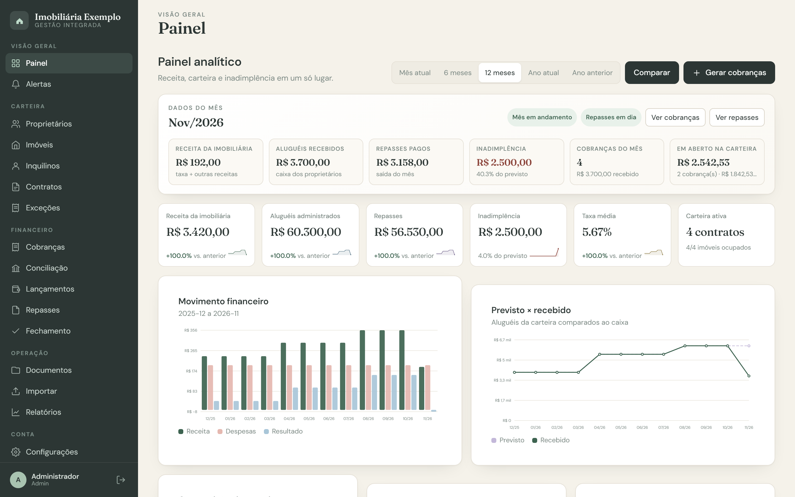
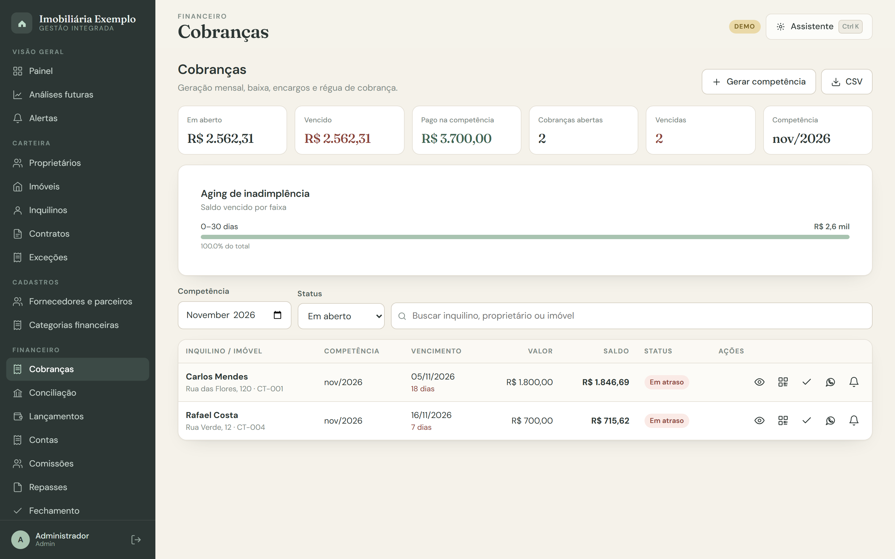
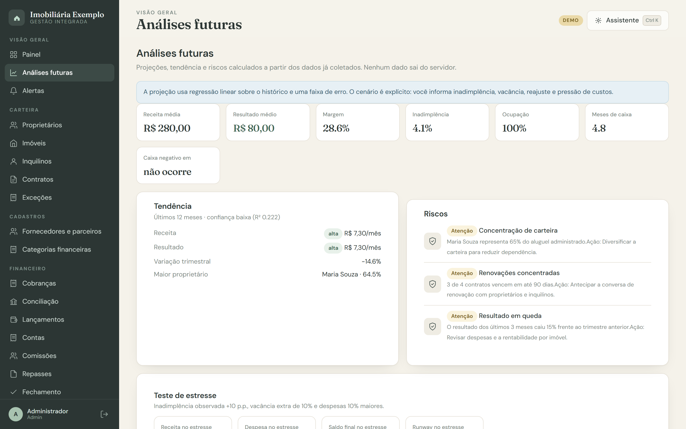
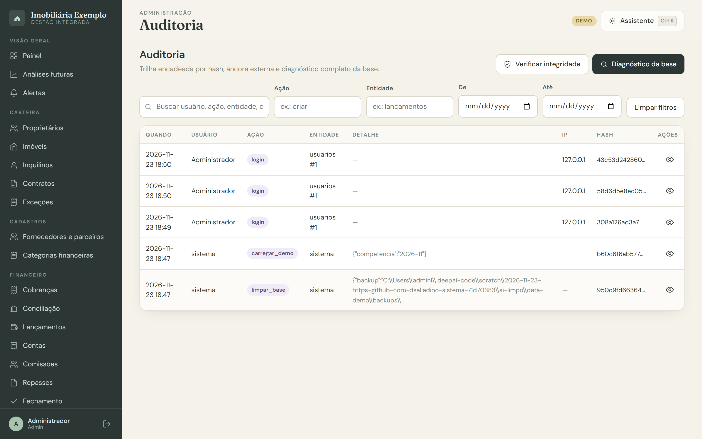
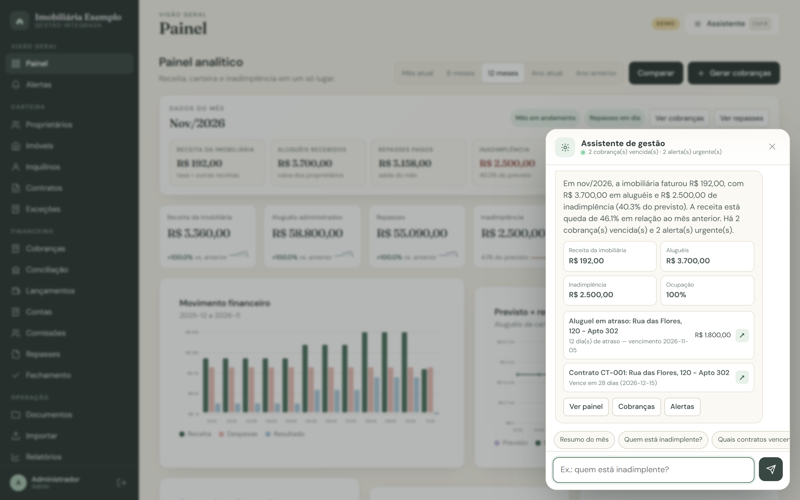
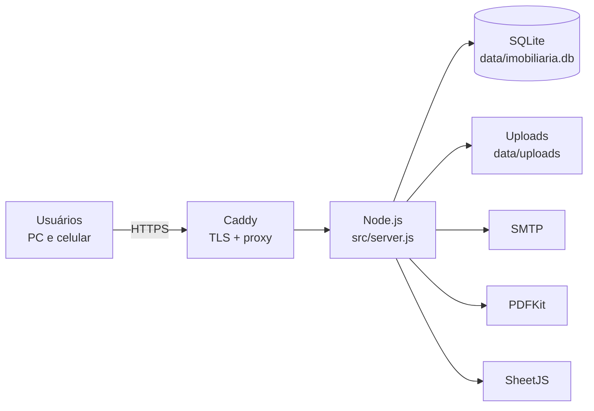

<p align="center">
  
</p>

<h1 align="center">Sistema de Gestão Imobiliária</h1>

<p align="center">
  <strong>A imobiliária inteira em um só lugar: contratos, cobranças, Pix, conciliação,<br>
  repasses, comissões, DRE, auditoria e análises futuras — no navegador, do PC ao celular.</strong>
</p>

<p align="center">
  <a href="https://github.com/DSalladino/sistema-imobiliaria/actions/workflows/ci.yml">
    
  </a>
  
  
  
  
  
</p>

<p align="center">
  <a href="#demonstração">Demonstração</a> ·
  <a href="#por-que-este-projeto-existe">O problema</a> ·
  <a href="#uma-volta-pelo-produto">Produto</a> ·
  <a href="#arquitetura">Arquitetura</a> ·
  <a href="#documentação">Documentação</a> ·
  <a href="#roadmap">Roadmap</a>
</p>

---

## Por que este projeto existe

Uma imobiliária familiar administra imóveis de terceiros, recebe aluguéis,
desconta a taxa de administração e repassa o saldo aos proprietários. Quando esse
processo vive em planilhas e mensagens:

- o mesmo aluguel aparece com valores ou datas **diferentes**;
- o repasse **não se explica** — ninguém sabe qual taxa foi aplicada nem por quê;
- o dinheiro da imobiliária **se mistura** com o dos proprietários;
- ninguém sabe **quem alterou o quê**, quando ou por quê.

Este projeto transforma esse ciclo em um fluxo único, auditável de ponta a ponta:

```text
cadastro → contrato → cobrança → recebimento → conciliação → repasse → fechamento
```

Foi desenhado para uma operação pequena — uma imobiliária, uma base, poucos
usuários — priorizando **simplicidade operacional**, **rastreabilidade** e
**baixo custo**. O resultado é um monólito Node.js + SQLite com frontend sem
build, 131 testes automatizados e documentação de ponta a ponta.

> **Status:** versão 0.11.0, em evolução ativa. O repositório não contém dados
> reais; a base de demonstração é separada da produção.

## Demonstração

A forma mais rápida de avaliar o projeto é a instância de demonstração: base
**isolada**, **dados fictícios**, sem informação comercial nem credencial real.

> **Demo online (somente leitura):**
> **https://dsalladino.github.io/sistema-imobiliaria/**
>
> Publicada pelo GitHub Pages com um retrato real da base de demonstração. Login,
> navegação, filtros, detalhes e assistente funcionam; cadastros e baixas são
> desabilitados para não alterar dados. Para testar escritas, rode localmente.

```bash
npm ci
npm run demo:preparar   # cria data-demo/ com 12 meses de histórico
npm run demo:servir     # http://127.0.0.1:3009
```

| Campo | Valor |
|---|---|
| E-mail | `admin@imobiliaria.local` |
| Senha | `Demo#2026` |

A senha é fixa **apenas na base descartável**; em produção não existe senha
padrão publicada. O roteiro de avaliação, o conteúdo da base de exemplo e as
instruções para gerar **capturas de tela** e o **vídeo de 90 s** estão em
[docs/DEMONSTRACAO.md](docs/DEMONSTRACAO.md).

| Painel | Cobranças |
|---|---|
|  |  |
| **Análises futuras** | **Trilha de auditoria encadeada** |
|  |  |
| **Assistente que conhece os números** | **No celular** |
|  |  |

[▶ Vídeo de 90 s](docs/assets/demonstracao.webm) ·
[todas as capturas](docs/assets/telas/) ·
[roteiro de avaliação](docs/DEMONSTRACAO.md#roteiro-de-avaliação-10-minutos)

## O que este projeto faz de diferente

- **Explica o repasse.** Cada competência guarda um *snapshot* com a taxa, a
  origem da regra e o cálculo por contrato — o repasse sempre se explica.
- **Separa o dinheiro.** Dois caixas: imobiliária e proprietários. O aluguel não
  se confunde com a receita da taxa.
- **Nada desaparece.** Lançamentos e baixas são corrigidos por estorno; cadastros
  são desativados; contratos são encerrados. Nada é editado por cima do histórico.
- **Mede o que deveria entrar.** Cobranças por contrato e competência, com aging,
  régua de cobrança, pagamento parcial e **Pix copia e cola com QR por cobrança**.
- **Prova a própria integridade.** Cada registro da trilha de auditoria encadeia
  o hash do anterior; editar o banco diretamente quebra a verificação. O
  **diagnóstico da base** confere duplicidades, vínculos, valores e integridade
  em um clique.
- **Decide com horizonte.** Análises futuras projetam receita, resultado e caixa
  com faixa de erro, riscos, simulador de cenário e **teste de estresse
  automático com runway** — tudo no banco local.
- **Assistente que conhece os números.** Perguntas em português — `Ctrl K` abre o
  assistente — sobre inadimplência, caixa, repasses, contratos e ocupação são
  respondidas pelo próprio banco, sem enviar dados a serviços externos.
- **Segurança de verdade.** Sessão server-side com expiração por inatividade, CSRF, CSP,
  rate limit, 2FA TOTP, upload privado, validação de CPF/CNPJ, LGPD e backup com
  ensaio real de restauração.
- **Dados de apoio que não se repetem.** Corretores (com CRECI e Pix),
  fornecedores, clientes e **categorias financeiras extensíveis** — o formulário
  deixa de depender de texto livre e o histórico não nasce com três grafias do
  mesmo nome.
- **Backup que se prova.** Snapshots automáticos com hash SHA-256 ao lado do
  arquivo, retenção configurável e ensaio de restauração que compara todas as
  tabelas — não apenas “o arquivo foi criado”.
- **Funciona no celular.** Layout responsivo com cartões no lugar de tabelas
  largas e gráficos SVG próprios, sem biblioteca externa.

## Uma volta pelo produto

| Módulo | O que resolve |
|---|---|
| **Painel** | KPIs do mês, comparativos, composição de receitas, ocupação, inadimplência, fluxo de caixa projetado e atividade recente |
| **Análises futuras** | Tendência, projeção com faixa de erro, riscos, recomendações, simulador de cenário e teste de estresse automático com runway |
| **Carteira** | Proprietários, imóveis, inquilinos, contratos, garantias, reajustes e exceções de taxa |
| **Cobranças** | Geração mensal em lote, baixa total/parcial, multa e juros, estorno, cancelamento, aging e régua, Pix copia e cola com QR por cobrança |
| **Conciliação** | Importação de OFX/CSV/Excel, sugestão de vínculo e confirmação humana |
| **Contas** | Contas a pagar e a receber com recorrência semanal a anual, baixa que gera lançamento e previsão de caixa de 6–24 meses |
| **Financeiro** | Dois caixas, lançamentos por competência, estornos, repasses com extrato e fechamento mensal |
| **Comissões** | Corretagem prevista/liberada/paga por contrato, corretor vinculado ao cadastro, geração em lote e lançamento de despesa |
| **Cadastros de apoio** | Corretores (com CRECI e Pix), fornecedores, clientes e categorias financeiras por contexto |
| **Documentos** | Upload vinculado a cadastros, versões, validade, pré-visualização e download autenticado |
| **Relatórios** | Oito relatórios em CSV, XLSX e PDF — incluindo **DRE por imóvel** — com cabeçalho, indicadores e paginação |
| **Importação** | Modelos de planilha, prévia linha a linha e atualização de registros existentes |
| **Comunicação** | WhatsApp por link `wa.me` ou API oficial (Cloud API), e e-mail SMTP com modelos, histórico e assinatura |
| **Assistente** | Perguntas em linguagem natural sobre inadimplência, caixa, repasses, contratos, reajustes, ocupação, comissões e contas — com números e atalhos para a tela certa (`Ctrl K`) |
| **Administração** | Usuários, papéis, auditoria encadeada com âncora de integridade, diagnóstico da base, 2FA, LGPD, backup automático com hash, manutenção e configurações |

Detalhes de cada fluxo, regras e telas em [docs/FUNCIONALIDADES.md](docs/FUNCIONALIDADES.md).

## Stack

| Camada | Escolha | Por quê |
|---|---|---|
| Runtime | **Node.js 22.13+** | `node:sqlite` nativo, sem build no backend |
| HTTP | **`node:http`** | Um processo, um deploy, sem framework |
| Banco | **SQLite + WAL** | Arquivo único, transações ACID, backup simples |
| Frontend | **HTML + CSS + ES Modules** | Zero build, longevidade e CSP restritiva |
| Gráficos | **SVG próprio** | Sem dependência de charts, controle visual |
| PDF | **PDFKit** | Relatórios e extratos com paginação |
| Planilhas | **SheetJS** | Importação e exportação XLSX/CSV |
| E-mail | **Nodemailer** | SMTP da imobiliária |
| Backup | **archiver + `VACUUM INTO`** | ZIP com banco, documentos e chave local |
| 2FA | **TOTP + QRCode** | Compatível com Google Authenticator/Authy |

## Começando

Requisito: **Node.js 22.13 ou superior** (recomendado 24+). O módulo
`node:sqlite` só fica disponível sem flag a partir dessa versão. O `.nvmrc` fixa
**24** para desenvolvimento; a CI cobre **22 e 24**.

```bash
npm install
npm start
```

Abra **http://localhost:3000**. O servidor escuta em `0.0.0.0` por padrão, então
também aceita acesso pelo IP da máquina na rede local. Para restringir à própria
máquina, use `HOST=127.0.0.1 npm start`.

Se algo não abrir, rode `npm run check` (ele valida Node, SQLite e permissão da
pasta de dados) e consulte [Solução de problemas](#solução-de-problemas).

- **E-mail inicial:** `admin@imobiliaria.local`
- **Senha:** gerada automaticamente na primeira execução e exibida **uma única
  vez** no terminal. Para definir antes, use `ADMIN_SENHA`.
- No primeiro login o sistema **obriga a criação de uma senha própria** (mínimo
  8 caracteres). Não existe senha padrão publicada.

Para abrir no celular na mesma rede, use o endereço `Na rede local` mostrado no
terminal. Se estiver em Docker ou atrás de proxy, mantenha `HOST=0.0.0.0` e
defina `TRUST_PROXY=1`.

### Base de demonstração separada

Para apresentar ao cliente **sem tocar nos dados reais**:

```bash
npm run demo:servir
```

O banco fica em `data-demo/` e a instância sobe em **http://127.0.0.1:3009**.
A produção continua intacta. Em produção (`NODE_ENV=production`) a base começa
vazia; dados de exemplo só entram com `SEED_DEMO=1` ou pelos comandos de
demonstração. O seed **nunca** roda por omissão, mesmo em desenvolvimento.

### Scripts

| Comando | O que faz |
|---|---|
| `npm start` | Sobe a aplicação |
| `npm run dev` | Sobe com `--watch` |
| `npm test` | 131 testes em 17 suítes: API, regras, segurança, interface (jsdom), seed, relatórios, conciliação, cadastros, assistente, auditoria e diagnóstico |
| `npm run check` | Verifica a sintaxe de todos os `.js`/`.mjs` |
| `npm run deps:check` | Confere versão, origem e integrity da dependência `xlsx` (CDN) |
| `npm run test:coverage` | Testes com cobertura experimental do Node |
| `npm run demo` | Recarrega os dados de exemplo |
| `npm run demo:preparar` | Cria a base de demonstração com credenciais conhecidas |
| `npm run demo:servir` | Sobe uma instância de demonstração isolada |
| `npm run demo:estatico` | Gera o retrato usado pela demo do GitHub Pages |
| `npm run midia:capturar` | Gera as capturas de tela (requer Playwright) |
| `npm run midia:video` | Grava o tour de 90 s (requer Playwright) |
| `npm run backup:testar` | Ensaia a restauração do backup |
| `npm run admin:reset` | Redefine a senha do admin pelo terminal |

## Arquitetura



O núcleo é um monólito com camadas claras:

- `src/server.js` — HTTP, sessão, CSP/cabeçalhos, estáticos e limite de corpo.
- `src/api.js` — rotas, validação, permissões, auditoria e uploads.
- `src/regras.js` — repasse, precedência de taxas, alertas, saldos e fechamento.
- `src/cobrancas.js` — geração, baixa, multa/juros, régua e aging.
- `src/conciliacao.js` — OFX/CSV, sugestões e confirmação.
- `src/analytics.js` — KPIs, séries, composição, comparativos e projeções.
- `src/previsao.js` — projeção com faixa de erro, riscos e teste de estresse.
- `src/auditoria.js` — trilha encadeada por hash, verificação e expurgo.
- `src/diagnostico.js` — diagnóstico da base: duplicidades, vínculos e integridade.
- `src/reports.js` — CSV, XLSX e PDF.
- `src/importacao.js` — planilhas, prévia e modelos.
- `src/cadastros.js` — parceiros (corretores, fornecedores e clientes) e categorias.
- `src/backup.js` — snapshots, hash SHA-256, retenção e ensaio de restauração.
- `src/db.js` — esquema, migrações, configurações e seed.
- `public/*` — SPA, gráficos SVG, assistente local e tema.

Leia [docs/ARQUITETURA.md](docs/ARQUITETURA.md) para os fluxos completos e
[docs/MODELO-DE-DADOS.md](docs/MODELO-DE-DADOS.md) para o dicionário de dados.
As decisões estão registradas em [docs/DECISOES.md](docs/DECISOES.md).

## Segurança

O projeto adota, entre outras práticas:

- **Senha:** `scrypt` com salt e comparação `timingSafeEqual`.
- **Sessão:** token de 256 bits, gravado no banco apenas como hash, cookie
  `HttpOnly`/`SameSite`/`Secure` sob HTTPS.
- **2FA TOTP:** QR Code, códigos de recuperação e reset pelo admin.
- **CSRF:** `SameSite` + JSON obrigatório + validação de `Origin` e
  `Sec-Fetch-Site`.
- **Rate limit:** login, 2FA, API, importação, comunicação e recuperação.
- **XSS:** escape na renderização e CSP sem script inline.
- **Sem terceiros no navegador:** fontes servidas pelo próprio sistema, sem
  CDN externo, o que preserva o modo offline e não envia o IP do usuário ao Google.
- **SQL:** consultas parametrizadas e referências validadas.
- **Upload:** limite de tamanho, extensões permitidas, nome aleatório, storage
  fora de `public/` e download autenticado.
- **Auditoria:** login, CRUD, estornos, repasses, fechamento, importação, backup
  e LGPD — encadeada por hash com âncora de integridade.
- **LGPD:** exportação do titular e anonimização preservando o histórico
  financeiro obrigatório.

O checklist de 21 pontos, com evidências e pendências, está em
[docs/checklist-seguranca.md](docs/checklist-seguranca.md). A análise de
**segurança e vulnerabilidades**, com o capítulo do Pix (ameaças, mitigações e
runbook), está em [docs/SEGURANCA.md](docs/SEGURANCA.md). Para reportar uma
vulnerabilidade, siga [SECURITY.md](SECURITY.md).

## Documentação

A documentação foi organizada como um produto, não como um anexo.

| Documento | Conteúdo |
|---|---|
| [docs/README.md](docs/README.md) | Índice e trilhas de leitura por perfil |
| [docs/DEMONSTRACAO.md](docs/DEMONSTRACAO.md) | Como rodar a demo, credenciais, capturas e roteiro do vídeo |
| [docs/PRODUTO.md](docs/PRODUTO.md) | Contexto, personas, escopo, jornadas, regras e glossário |
| [docs/FUNCIONALIDADES.md](docs/FUNCIONALIDADES.md) | Cada funcionalidade: problema, regras e onde encontrar |
| [docs/ARQUITETURA.md](docs/ARQUITETURA.md) | Diagramas, camadas, fluxos, segurança e limites |
| [docs/MODELO-DE-DADOS.md](docs/MODELO-DE-DADOS.md) | ER, dicionário de tabelas e invariantes |
| [docs/API.md](docs/API.md) | Rotas, autenticação, permissões e exemplos |
| [docs/QUALIDADE.md](docs/QUALIDADE.md) | Testes, CI, checklist manual e lacunas |
| [docs/OPERACAO.md](docs/OPERACAO.md) | Rotina, backup, restauração e runbooks |
| [docs/DECISOES.md](docs/DECISOES.md) | ADRs e trade-offs |
| [docs/ESTUDO-DE-CASO.md](docs/ESTUDO-DE-CASO.md) | Narrativa do problema, solução, resultados e aprendizados |
| [docs/ESTADO-ATUAL.md](docs/ESTADO-ATUAL.md) | Fotografia técnica da versão atual e dívidas |
| [docs/AUDITORIA.md](docs/AUDITORIA.md) | Achados da revisão técnica, correções e riscos residuais |
| [docs/SEGURANCA.md](docs/SEGURANCA.md) | Modelo de ameaças, análise do Pix (P-01…P-14) e runbook |
| [docs/checklist-seguranca.md](docs/checklist-seguranca.md) | Auditoria de 21 pontos com evidências e pendências |
| [docs/roadmap.md](docs/roadmap.md) | Prioridades em fases |
| [deploy/README.md](deploy/README.md) | VPS, domínio, HTTPS, systemd, backup e go-live |
| [CONTRIBUTING.md](CONTRIBUTING.md) | Ambiente, padrões, testes e fluxo de PR |
| [CHANGELOG.md](CHANGELOG.md) | Evolução por versão (SemVer) |

## Testes

```bash
npm run check
npm test
```

| Suíte | Cobre |
|---|---|
| `tests/api.test.mjs` | Login, sessão, CSRF, CRUD, cobranças, repasses, relatórios, backup, fechamento e proteção do último admin |
| `tests/rules.test.mjs` | Precedência de taxas, snapshot, senha, CSV, repasse e importação |
| `tests/seguranca.test.mjs` | TOTP (vetores do RFC 6238), base32, cifragem AES-GCM, códigos de recuperação e política de senha |
| `tests/seguranca-avancada.test.mjs` | RBAC, CSRF e injeção em filtros contra a API real |
| `tests/features.test.mjs` | Pix, WhatsApp, contas e recorrência, previsão de caixa, reajuste em lote, rescisão, comissões e DRE por imóvel |
| `tests/ui.test.mjs` | Renderiza as telas com dados reais em jsdom |
| `tests/seed.test.mjs` | Valida a base de demonstração da primeira execução |
| `tests/relatorios.test.mjs` | CSV/XLSX/PDF, fórmulas, acentos, período vazio e DRE |
| `tests/conciliacao.test.mjs` | OFX, CSV, sugestão, duplicidade, txid e confirmação |
| `tests/analytics.test.mjs` | Série, ocupação, composição, KPIs e cache de settings |
| `tests/previsao.test.mjs` | Projeção, faixa de erro, riscos e teste de estresse |
| `tests/auditoria.test.mjs` | Encadeamento de hash, verificação e expurgo |
| `tests/backup.test.mjs` | Snapshot, hash, retenção e ensaio de restauração |
| `tests/cadastros.test.mjs` | Parceiros, categorias, vínculo de corretor e hash de snapshot |
| `tests/assistente.test.mjs` | Interpretação de período, resumo, caixa, ocupação e inadimplência |
| `tests/validacao.test.mjs` | Validação de CPF/CNPJ e campos de formulário |
| `tests/diagnostico.test.mjs` | Diagnóstico da base: duplicidades, vínculos e integridade |

O CI roda em Node 22 e 24. A estratégia e as lacunas estão em
[docs/QUALIDADE.md](docs/QUALIDADE.md).

## Backup e restauração

- **Backup:** Relatórios → “Baixar backup do banco”. O `.zip` inclui o banco, a
  pasta de documentos e, quando existir, a chave local `.app-key`.
- **Snapshots:** ao iniciar, o sistema cria um snapshot automático se o último
  tiver mais de 24 h (configurável). Cada arquivo recebe um `.sha256` ao lado.
- **Verificação:** Relatórios → “Verificar integridade” abre o banco gerado e
  confere tabelas, chaves estrangeiras, contagens e o hash dos snapshots.
- **Ensaio:** `npm run backup:testar` restaura o snapshot em um diretório
  temporário e compara todas as tabelas.
- **Restauração:** pare o servidor, substitua `data/imobiliaria.db`, copie
  `documentos/` para `data/uploads` e `.app-key` para `data/.app-key`, remova
  `-wal`/`-shm` antigos e suba novamente.
- O ZIP contém dados pessoais e possivelmente segredos. Guarde-o criptografado,
  fora do servidor, e teste a restauração periodicamente.

Runbook completo em [docs/OPERACAO.md](docs/OPERACAO.md).

## Publicação

O sistema precisa de **um servidor com disco persistente** (Node + SQLite +
arquivos). Vercel e hospedagem compartilhada não servem. O guia completo está em
[deploy/README.md](deploy/README.md). Para uma demo pública com escritas, use o passo a passo
de [docs/DEPLOY-DEMO.md](docs/DEPLOY-DEMO.md) (Render, Fly.io ou Docker). A demo
somente leitura do GitHub Pages é publicada automaticamente pelo workflow
`.github/workflows/pages.yml`.

- **Menor custo com persistência:** VPS pequena (1 GB RAM) ou Oracle Cloud
  Always Free.
- **Domínio:** um domínio pago ou `seu-nome.duckdns.org` / `191-123-45-67.sslip.io`.
- **HTTPS:** automático com Caddy.
- **Backup:** diário, externo, com teste de restauração.

### Antes de colocar em produção

1. Trocar a senha do admin e criar usuários individuais.
2. Rodar atrás de HTTPS (`TRUST_PROXY=1`).
3. Definir um `APP_SECRET` forte e guardá-lo no gerenciador de senhas.
4. Automatizar backup offsite e testar a restauração.
5. Revisar as regras de taxa com a imobiliária e validar com casos reais.
6. Revisar LGPD e contratos com apoio jurídico.
7. Rodar `npm audit` e manter as dependências atualizadas.

### Variáveis de ambiente

| Variável | Para que serve |
|---|---|
| `PORT` | Porta HTTP (padrão 3000) |
| `HOST` | Interface de escuta (padrão `0.0.0.0`; use `127.0.0.1` para acesso só local) |
| `DATA_DIR` | Pasta do banco (padrão `./data`) |
| `TRUST_PROXY=1` | Usa `X-Forwarded-For`/`X-Forwarded-Proto` atrás de proxy |
| `APP_SECRET` | Cifra segredos de 2FA e códigos de recuperação |
| `ADMIN_SENHA` | Senha inicial do admin na primeira execução (opcional) |
| `PUBLIC_URL` | URL pública usada nos links de e-mail |
| `SMTP_*` | Configuração de envio de e-mail |
| `WHATSAPP_TOKEN` | Token da API oficial do WhatsApp (Cloud API) |
| `WHATSAPP_PHONE_ID` | ID do número na Cloud API |
| `WHATSAPP_API_VERSION` | Versão da Graph API (padrão `v21.0`) |
| `SEED_DEMO=1` | Carrega demonstração em produção (use com cuidado) |
| `DEMO_MODE=1` | Ativa a faixa de demo, credenciais de teste e `noindex` |
| `DEMO_DATA_DIR` | Pasta isolada da demonstração (padrão `./data-demo`) |
| `DEMO_RESET_HORAS` | Restaura a demo a cada N horas (padrão 6; `0` desliga) |

Sem `SEED_DEMO=1` a base começa sempre vazia, inclusive fora de produção.

### Solução de problemas

| Sintoma | Causa provável | O que fazer |
|---|---|---|
| Tela branca/spinner eterno | JavaScript não carregou ou servidor fora do ar | Abra `/api/health`; depois de 12s a própria tela mostra o diagnóstico |
| `ERR_UNKNOWN_BUILTIN_MODULE: node:sqlite` | Node anterior a 22.13 | Instale o Node 24 LTS (`nvm install 24`) e rode `npm start` |
| `A porta 3000 já está em uso` | Outra instância rodando | `PORT=3010 npm start` |
| `EACCES`/`EPERM` na pasta de dados | Permissão de escrita | Use `DATA_DIR` apontando para uma pasta gravável |
| Abre só em `localhost`, não no celular | `HOST=127.0.0.1` | Use o padrão `0.0.0.0` e o IP mostrado no terminal |
| Login da demo pede troca de senha | Banco criado fora de `npm run demo:servir` | Rode `npm run demo:preparar` antes |

## Estrutura

```text
src/            HTTP, API, regras, banco, relatórios e integrações
public/         SPA em JavaScript puro, estilos, gráficos e assistente
tests/          17 suítes de teste (node:test + jsdom)
docs/           produto, arquitetura, dados, API, qualidade, operação e ADRs
deploy/         systemd, Caddy, backup e guia de publicação
scripts/        captura de mídia e verificação de ambiente
.github/        CI, templates de issue e pull request
data/           banco e uploads (gerado; não versionar)
```

## Roadmap

**Fase 1 — consolidação (concluída na 0.11.0):** reajuste em lote, rescisão,
contas a pagar/receber com previsão de caixa, comissões, DRE por imóvel, Pix,
auditoria encadeada, cadastros de apoio e análises futuras com teste de estresse.

**Fase 2 — transparência:** portal do proprietário, portal do inquilino, central
de manutenção, histórico do imóvel e dashboard por bairro/tipo.

**Fase 3 — escala:** multiempresa, permissões granulares, assinatura
digital, integração contábil, API pública e observabilidade.

Detalhes, esforço e ordem em [docs/roadmap.md](docs/roadmap.md).

## O que ainda não está incluído

- Boleto bancário registrado e baixa automática por webhook de PSP (o Pix já é
  gerado como BR Code estático, com QR e copia e cola por cobrança).
- Central de manutenção, portal do proprietário/inquilino e OCR.
- Antivírus no upload, criptografia em repouso e backup offsite nativo.
- Permissões granulares por módulo/proprietário e multiempresa.

## Contribuição

Sugestões, correções e melhorias são bem-vindas. Leia
[CONTRIBUTING.md](CONTRIBUTING.md), abra uma issue com contexto e rode
`npm run check` + `npm test` antes de enviar um pull request. Este projeto segue
um [Código de Conduta](CODE_OF_CONDUCT.md).

## Licença

Distribuído sob a licença [MIT](LICENSE).

<p align="center">
  Feito com cuidado por <a href="https://github.com/DSalladino">DSalladino</a><br>
  <sub>Node.js · SQLite · JavaScript puro · documentação de ponta a ponta</sub>
</p>
