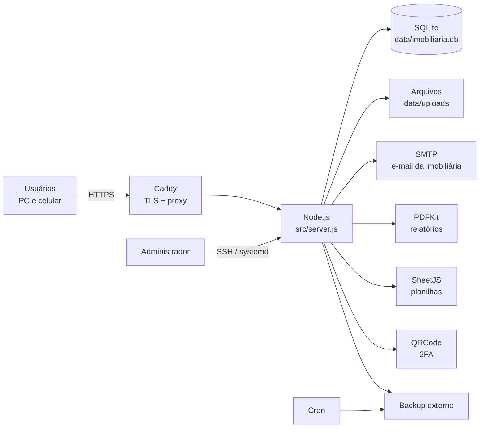
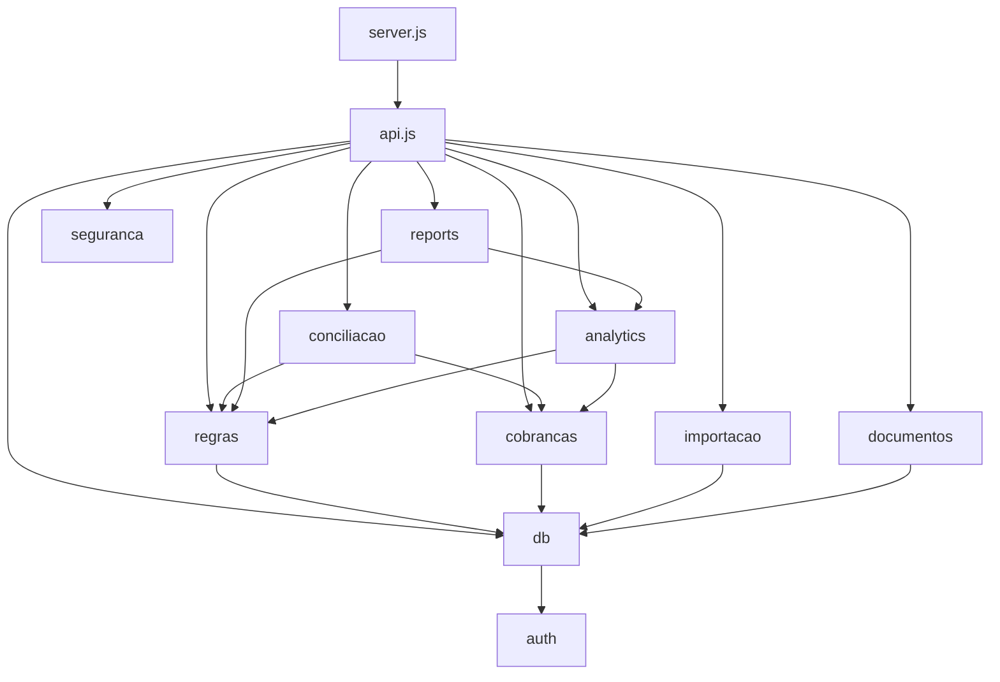
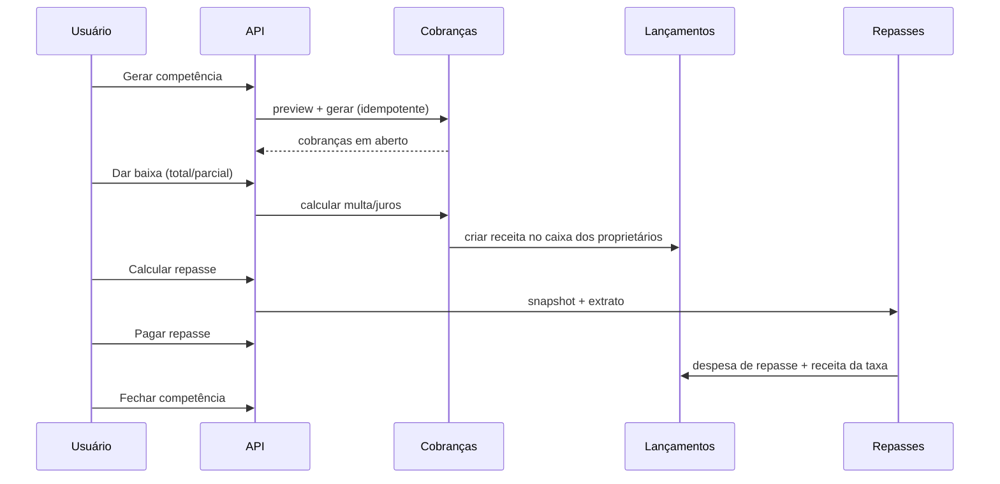
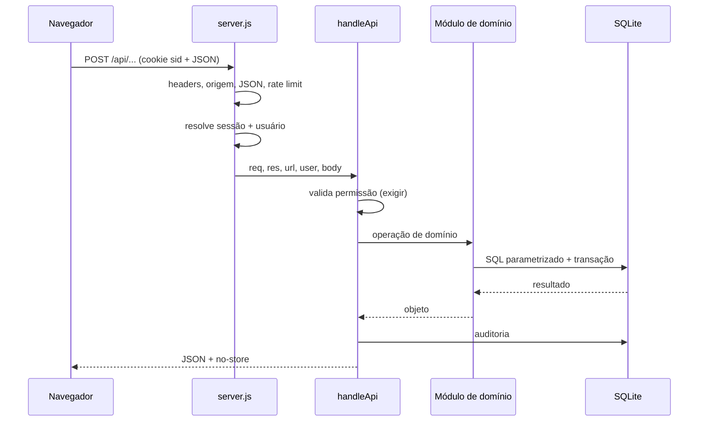

# Arquitetura

## Visão em uma frase

Aplicação **Node.js monolítica** com **SQLite em disco**, servida por HTTP atrás
de Caddy/HTTPS, com frontend SPA em JavaScript puro e geração própria de
gráficos SVG.

## Contexto e forças

- Uma imobiliária, uma base, até ~20 usuários.
- Operação em computador e celular, com baixo custo de hospedagem.
- Necessidade de backup simples, auditoria e explicação de cálculos.
- Pouca equipe: cada peça a mais precisa se pagar em valor operacional.
- Dados financeiros e pessoais: segurança e rastreabilidade são requisitos.

Decisões detalhadas em [DECISOES.md](DECISOES.md).

## Visão de contexto

## Camadas

| Camada | Arquivo | Responsabilidade |
|---|---|---|
| HTTP | `src/server.js` | Sessão, cookies, CSP/cabeçalhos, estáticos, limite de corpo |
| API | `src/api.js` | Rotas, validação, permissões, auditoria, uploads |
| Regras | `src/regras.js` | Repasse, taxas, alertas, saldos, fechamento |
| Cobranças | `src/cobrancas.js` | Geração, baixa, multa/juros, régua, aging |
| Conciliação | `src/conciliacao.js` | OFX/CSV, candidatos, confirmação |
| Analytics | `src/analytics.js` | KPIs, séries, composição, comparativos |
| Documentos | `src/documentos.js` | Upload, versões, validade, download |
| Segurança | `src/seguranca.js` | TOTP, AES do segredo, recovery codes |
| Relatórios | `src/reports.js` | CSV, XLSX, PDF |
| Importação | `src/importacao.js` | Leitura de planilhas e modelos |
| E-mail | `src/email.js` | SMTP |
| Dados | `src/db.js` | Esquema, migrações, settings, seed |
| Interface | `public/*` | SPA, gráficos, ícones, tema |

### Dependências entre módulos

`api.js` é o único ponto de entrada HTTP. Módulos de domínio não conhecem
`req`/`res`; recebem dados simples e devolvem objetos. Isso facilita testes e
mantém a validação concentrada na borda.

## Modelo de dados

O diagrama completo e o dicionário estão em [MODELO-DE-DADOS.md](MODELO-DE-DADOS.md).
Resumo por grupo:

- **Acesso:** `usuarios`, `sessoes`, `auditoria`, `password_resets`.
- **Cadastros:** `proprietarios`, `imoveis`, `inquilinos`, `contratos`, `excecoes`.
- **Recebíveis:** `cobrancas`, `cobranca_acoes`.
- **Caixa:** `lancamentos` (dois caixas), `repasses`, `fechamentos`.
- **Conciliação:** `conciliacoes`.
- **Documentos:** `documentos` (grupo, versão, atual, validade).
- **Comunicação:** `comunicacoes`.
- **Configuração:** `settings`.

Convenções: dinheiro em centavos, percentual `REAL`, datas `YYYY-MM-DD`,
competência `YYYY-MM`.

## Fluxo principal: cobrança → caixa → repasse

## Fluxo de uma requisição

## Decisões importantes

### Precedência de taxas

Geral → proprietário → imóvel → contrato. A regra mais específica vence. O
repasse grava a taxa e a origem em `detalhe_json`; mudanças futuras não
reescrevem o passado.

### Dois caixas

O aluguel entra no caixa dos proprietários; a taxa da imobiliária entra no caixa
próprio. O repasse é uma saída do caixa dos proprietários. Isso evita confundir
dinheiro de terceiros com receita.

### Nada se apaga

Lançamentos usam estorno; cobranças pagas usam estorno de baixa; contratos são
encerrados; cadastros são desativados. A auditoria guarda o antes/depois.

### Fechamento mensal

Uma competência fechada bloqueia lançamentos, cobranças e repasses. Só o admin
reabre, com motivo.

### Snapshot

O repasse guarda o cálculo completo. O extrato pode ser reimpresso anos depois
com os mesmos valores.

### Snapshot e contratos encerrados

O repasse considera **receita de aluguel recebida na competência**, mesmo que o
contrato tenha sido encerrado depois. O que importa é o fato gerador financeiro,
não o status atual do contrato.

## Segurança

- Senha: `scrypt` + salt, comparação `timingSafeEqual`.
- Sessão: token de 256 bits guardado como hash SHA-256, `HttpOnly`,
  `SameSite=Lax`, `Secure` sob HTTPS, invalidação em massa.
- 2FA: TOTP, segredo cifrado com AES-256-GCM (`APP_SECRET` ou chave local),
  códigos de recuperação com HMAC.
- Rate limit: login, 2FA, API, importação, comunicação e recuperação.
- CSRF: `SameSite` + JSON obrigatório + validação de `Origin` e `Sec-Fetch-Site`.
- XSS: escape na renderização; CSP sem script inline.
- SQL: consultas parametrizadas; filtros numéricos validados.
- Upload: tamanho, extensão, nome aleatório, storage fora da pasta pública,
  download autenticado.
- Auditoria: login, falhas, CRUD, estorno, repasse, fechamento, importação,
  backup e LGPD.

Checklist completo em [checklist-seguranca.md](checklist-seguranca.md).

## Testes

- `tests/api.test.mjs`: API e regras de negócio, em banco temporário.
- `tests/rules.test.mjs`: precedência, snapshot, CSV, repasse e importação.
- `tests/ui.test.mjs`: HTML real em jsdom, login, troca de senha, telas, modais,
  gráficos.
- `tests/seed.test.mjs`: carga inicial da demonstração.

O banco de teste usa `DATA_DIR` temporário; nunca toca nos dados reais. Detalhes
em [QUALIDADE.md](QUALIDADE.md).

## Limites conhecidos

- **Single-tenant:** todos os usuários veem a mesma imobiliária.
- **Sem atualização em tempo real:** a tela reflete o servidor ao navegar/atualizar.
- **Sem concorrência otimista:** duas edições simultâneas no mesmo registro podem
  sobrescrever.
- **SQLite:** exige um único processo gravando; não usar em pasta de rede.
- **Listas sem paginação:** limites fixos de 500 a 1.000 registros.
- **Sem storage de objetos:** uploads crescem no disco local.
- **Sem fila:** envio de e-mail e geração de PDF são síncronos.
- **Para dezenas de milhares de documentos/usuários:** migrar para PostgreSQL +
  storage de objetos e separar o processamento de arquivos.

## Evolução recomendada

1. Contas a pagar/receber e previsão de caixa.
2. Reajuste em lote com termo.
3. Rescisão de contrato e devolução de caução.
4. Portal do proprietário/inquilino.
5. Permissões granulares e multiempresa.
6. Observabilidade (logs estruturados, métricas, alertas).

O [roadmap](roadmap.md) detalha o que vem antes e por quê.
