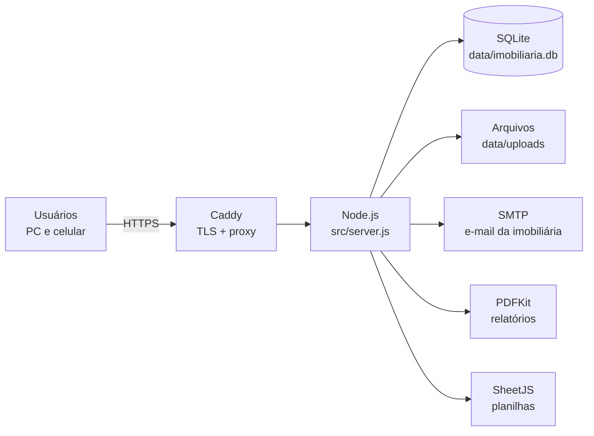
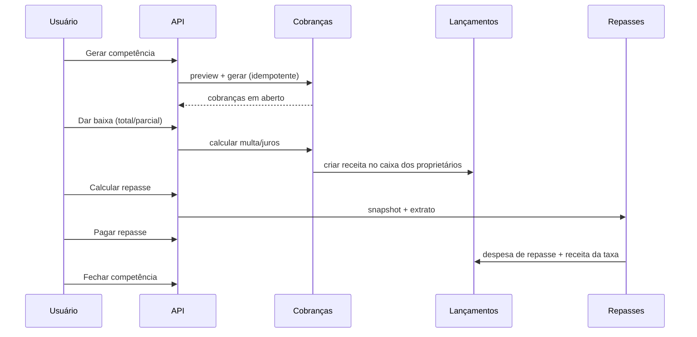

# Arquitetura

## Visão em uma frase

Aplicação **Node.js monolítica** com **SQLite em disco**, servida por HTTP e protegida por Caddy/HTTPS,
com frontend SPA em JavaScript puro e geração própria de gráficos SVG.

## Diagrama de contexto

## Por que essa arquitetura

- **5 usuários, uma empresa:** não há necessidade de microserviços, filas ou banco distribuído.
- **SQLite:** um arquivo, backup simples, transações ACID, sem servidor de banco para administrar.
- **Monólito:** um processo, um deploy, um log, um backup. Menos partes para quebrar.
- **Sem build no frontend:** HTML/CSS/JS servidos diretamente; menos ferramentas e mais longevidade.
- **Gravação em centavos:** evita erro de ponto flutuante em dinheiro.

## Camadas

| Camada | Arquivo | Responsabilidade |
|---|---|---|
| HTTP | `src/server.js` | Sessão, cookies, CSP/headers, estáticos, limite de corpo |
| API | `src/api.js` | Rotas, validação, permissões, auditoria, uploads |
| Regras | `src/regras.js` | Repasse, alertas, saldos, fechamento |
| Cobranças | `src/cobrancas.js` | Geração, baixa, multa/juros, régua, aging |
| Conciliação | `src/conciliacao.js` | OFX/CSV, candidatos, confirmação |
| Analytics | `src/analytics.js` | KPIs, séries, composição, comparativos |
| Documentos | `src/documentos.js` | Upload, versões, validade, download |
| Segurança | `src/seguranca.js` | TOTP, AES do segredo, recovery codes |
| Relatórios | `src/reports.js` | CSV, XLSX, PDF |
| Importação | `src/importacao.js` | Leitura de planilhas e modelos |
| E-mail | `src/email.js` | SMTP |
| Dados | `src/db.js` | Esquema, migrações, settings, seed |
| Interface | `public/*` | SPA, gráficos, ícones, tema |

## Modelo de dados (grupos)

- **Acesso:** `usuarios`, `sessoes`, `auditoria`.
- **Cadastros:** `proprietarios`, `imoveis`, `inquilinos`, `contratos`, `excecoes`.
- **Recebíveis:** `cobrancas`, `cobranca_acoes`.
- **Caixa:** `lancamentos` (dois caixas), `repasses`, `fechamentos`.
- **Conciliação:** `conciliacoes`.
- **Documentos:** `documentos` (grupo, versão, atual, validade).
- **Comunicação:** `comunicacoes`.
- **Configuração:** `settings`.

Convenções: dinheiro em centavos (`INTEGER`), percentual `REAL`, datas `YYYY-MM-DD`, competência
`YYYY-MM`.

## Fluxo principal: cobrança → caixa → repasse

## Decisões importantes

### Precedência de taxas
Geral → proprietário → imóvel → contrato. A regra mais específica vence. O repasse grava a taxa e a
origem em `detalhe_json`, então mudanças futuras não reescrevem o passado.

### Dois caixas
O aluguel entra no caixa dos proprietários; a taxa da imobiliária entra no caixa próprio. O repasse é
uma saída do caixa dos proprietários. Isso evita confundir dinheiro de terceiros com receita.

### Nada se apaga
Lançamentos usam estorno; cobranças pagas usam estorno de baixa; contratos são encerrados; cadastros
são desativados. A auditoria guarda o antes/depois.

### Fechamento mensal
Uma competência fechada bloqueia lançamentos, cobranças e repasses. Só o admin reabre, com motivo.

### Snapshot
O repasse guarda o cálculo completo. O extrato pode ser reimpresso anos depois com os mesmos valores.

## Segurança

- Senha: `scrypt` + salt, comparação `timingSafeEqual`.
- Sessão: token de 256 bits guardado no banco como hash SHA-256, `HttpOnly`, `SameSite=Lax`, `Secure` sob HTTPS, invalidação em massa.
- 2FA: TOTP, segredo cifrado com AES-256-GCM (`APP_SECRET` ou chave local).
- Rate limit: login, 2FA, API e importação.
- CSRF: `SameSite` + JSON obrigatório + validação de `Origin` e `Sec-Fetch-Site`.
- XSS: escape na renderização; CSP sem script inline.
- SQL: consultas parametrizadas; filtros numéricos validados.
- Upload: tamanho, extensão, nome aleatório, storage fora da pasta pública, download autenticado.
- Auditoria: login, falhas, CRUD, estorno, repasse, fechamento, importação, backup, LGPD.

## Testes

- `tests/api.test.mjs`: API e regras de negócio, em banco temporário.
- `tests/relatorios.test.mjs`: CSV/XLSX/PDF, modelos e importação.
- `tests/ui.test.mjs`: HTML real em jsdom, login, troca de senha, telas, modais, gráficos.

O banco de teste usa `DATA_DIR` temporário; nunca toca nos dados reais.

## Limites conhecidos

- Single-tenant: todos os usuários veem a mesma imobiliária.
- Sem atualização em tempo real; a tela reflete o servidor ao navegar/atualizar.
- Sem concorrência otimista: duas edições simultâneas no mesmo registro podem sobrescrever.
- SQLite exige um único processo gravando; não usar em pasta de rede.
- Para dezenas de milhares de documentos/usuários, migrar para Postgres + storage de objetos.
