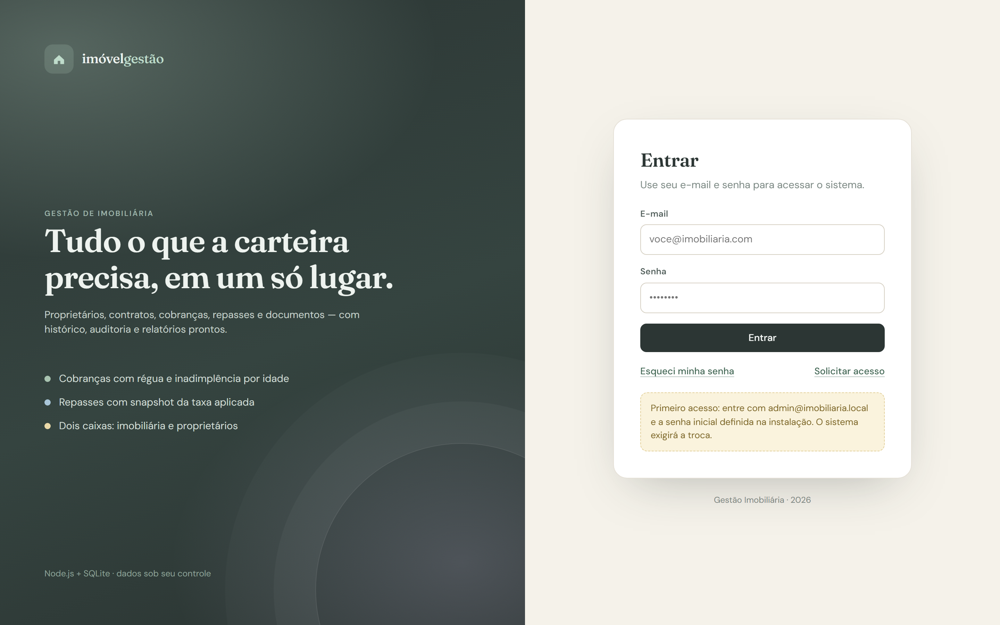
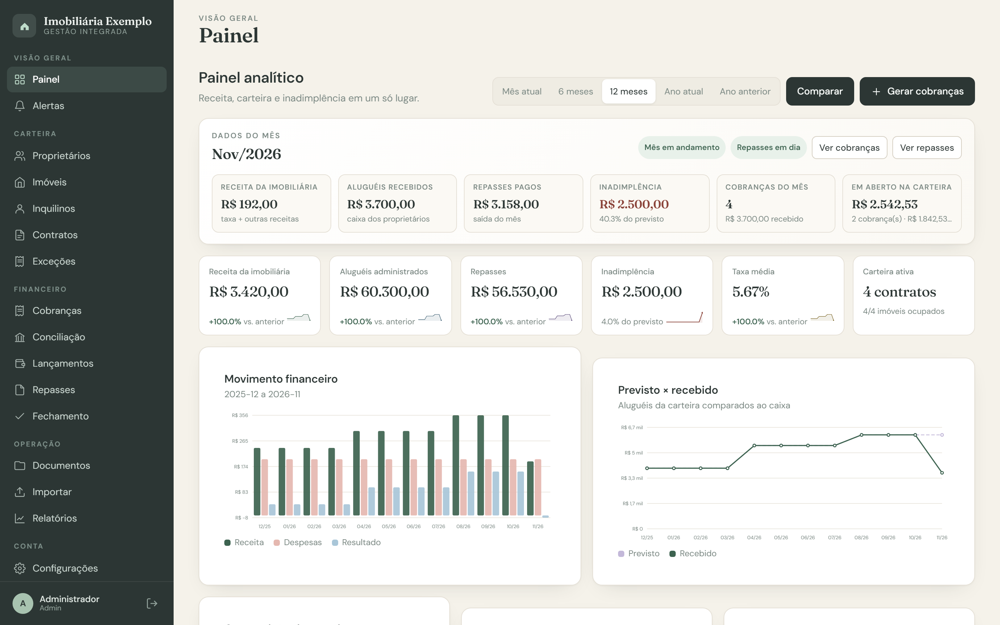
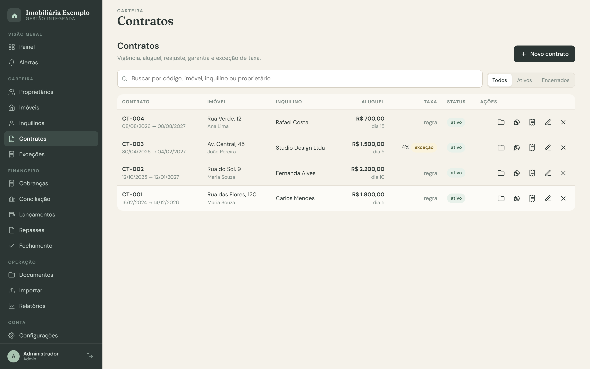
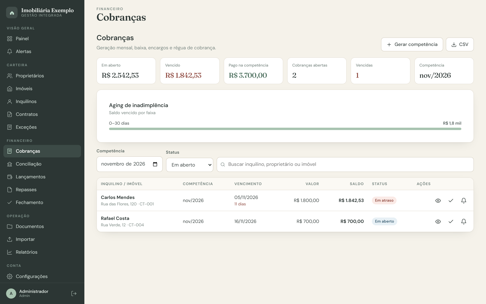
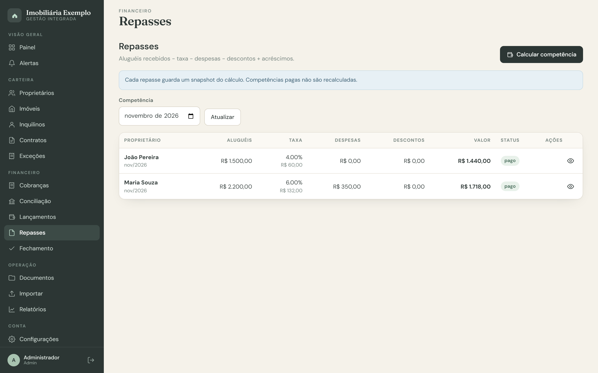
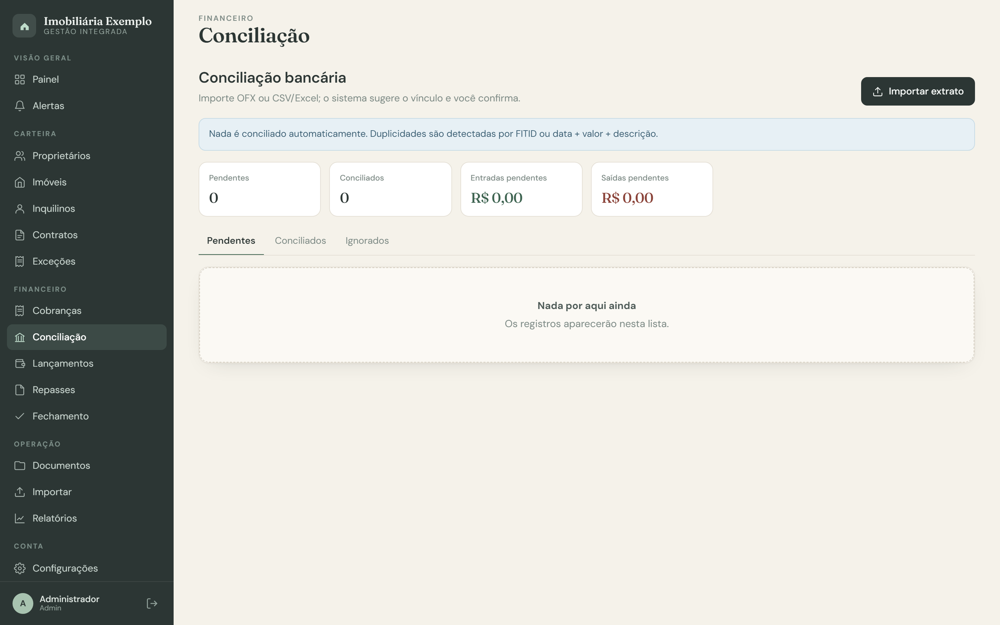
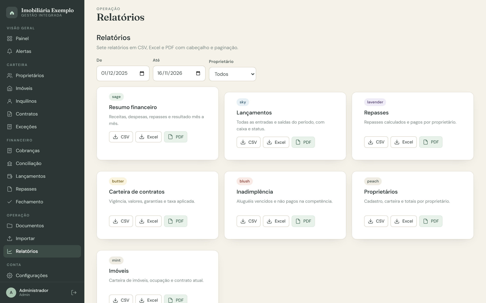
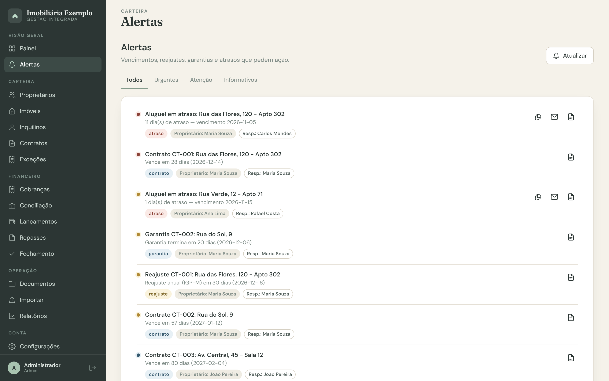
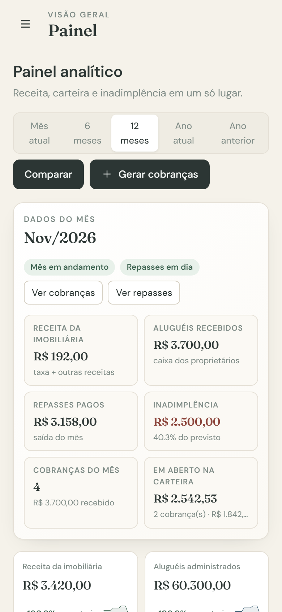
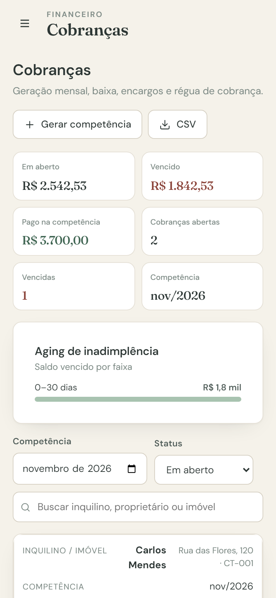

# Demonstração

Esta é a forma recomendada de avaliar o projeto: uma instância **isolada**, com
**dados fictícios**, sem nenhuma informação comercial ou credencial real. A base
de produção nunca é tocada.

## Subir em três comandos

```bash
npm ci
npm run demo:preparar   # cria data-demo/ com dados de exemplo
npm run demo:servir     # http://127.0.0.1:3009
```

O `demo:preparar` sempre recria a base com dados novos; o `demo:servir`
reaproveita a base existente e só a cria se ainda não houver. Para recomeçar do
zero, rode `npm run demo:preparar` de novo (ou apague `data-demo/`).

### Credenciais de demonstração

| Campo | Valor |
|---|---|
| E-mail | `admin@imobiliaria.local` |
| Senha | `Demo#2026` |
| Papel | administrador |

A senha é fixa **somente nesta base descartável**, para que qualquer pessoa
consiga entrar sem pedir acesso. Em produção o projeto não cria senha padrão:
a senha inicial vem de `ADMIN_SENHA` ou é gerada aleatoriamente e exibida uma
única vez no terminal. É possível trocar a senha da demonstração com
`DEMO_SENHA='Outra#Senha' npm run demo:preparar`.

## O que existe na base de exemplo

- **3 proprietários**, **4 imóveis** e **4 inquilinos** com nomes, documentos,
  contatos e bancos fictícios (`@exemplo.com`).
- **4 contratos ativos** com garantias diferentes (fiador, caução, sem garantia),
  índices de reajuste distintos e uma **exceção de taxa** aprovada.
- **12 meses de histórico**: cobranças geradas por competência, pagamentos totais
  e parciais, multa e juros, e repasses calculados e pagos com snapshot da taxa.
- **Dois caixas** (imobiliária e proprietários) com lançamentos por competência.
- Telas de **conciliação** e **documentos** começam vazias de propósito: mostram
  o estado inicial de quem ainda não importou extrato nem anexou arquivos.

Nada disso vem de clientes reais. Os dados são gerados por `seedDemo()` em
`src/db.js` e `carregarDemo()` em `src/manutencao.js`, sempre relativos à data
atual — a demonstração nunca “envelhece”.

## Roteiro de avaliação (10 minutos)

1. **Painel** — KPIs do mês, composição de receitas, ocupação, inadimplência,
   alertas e atividade recente.
2. **Contratos** — abra um contrato e veja garantia, reajuste e a regra de taxa
   com a justificativa da exceção.
3. **Cobranças** — filtre por competência, veja o aging e faça uma baixa parcial
   para observar multa e juros.
4. **Conciliação** — importe um OFX/CSV fictício e confirme uma sugestão de
   vínculo (a confirmação é sempre humana).
5. **Repasses** — abra o extrato de um repasse: taxa aplicada, origem da regra e
   o cálculo contrato a contrato.
6. **Relatórios** — exporte o mesmo relatório em CSV, XLSX e PDF.
7. **Celular** — reduza a janela ou abra no telefone: as tabelas viram cartões.

## Capturas de tela

As imagens ficam em [`docs/assets/telas/`](assets/telas/) e são geradas a partir
da própria demonstração, para não envelhecerem:

| Login | Painel |
|---|---|
|  |  |
| **Contratos** | **Cobranças** |
|  |  |
| **Repasses** | **Conciliação** |
|  |  |
| **Relatórios** | **Alertas** |
|  |  |
| **Painel no celular** | **Cobranças no celular** |
|  |  |

Para regerar depois de mudar a interface:

```bash
npm i -D playwright
npx playwright install chromium
npm run demo:servir                 # em outro terminal
node scripts/capturar-telas.mjs     # grava as 10 telas
```

O script usa `APP_URL` (padrão `http://127.0.0.1:3009`) e `DEMO_SENHA`. Ele
captura login, painel, contratos, cobranças, repasses, conciliação, relatórios,
alertas e duas telas no celular.

> As imagens são produzidas localmente. Nenhuma captura é enviada para fora da
> máquina.

## Vídeo curto

O [vídeo de ~90 s](assets/demonstracao.webm) segue o mesmo caminho do tour
acima, com legendas sobrepostas (sem áudio, para funcionar em qualquer lugar).
Para regravá-lo:

```bash
npm run demo:servir                 # em outro terminal
node scripts/gravar-demo.mjs        # gera docs/assets/demonstracao.webm
```

O arquivo `.webm` abre direto no navegador. Para MP4, converta com
`ffmpeg -i docs/assets/demonstracao.webm -c:v libx264 -pix_fmt yuv420p demonstracao.mp4`
ou publique o `.webm` como está (Chrome, Firefox e Edge reproduzem).

## Testes automatizados

A suíte é pública e roda sem a demonstração no ar:

```bash
npm run check   # sintaxe
npm test        # 20 testes: API, regras, interface (jsdom) e seed
```

Ela cobre login e sessão, CSRF, permissões, precedência de taxas, geração e baixa
de cobranças, repasse com snapshot, fechamento, importação e a renderização de
todas as telas com dados reais da demonstração. Detalhes em
[QUALIDADE.md](QUALIDADE.md).

## O que não está na demonstração

- Dados de clientes, contratos, valores e credenciais reais.
- Integrações de produção (SMTP, backup externo, domínio, HTTPS).
- Arquivos enviados por usuários e extratos bancários reais.
- O código de personalizações comerciais feitas sob medida para a operação.

O restante — produto, arquitetura, modelo de dados e decisões — está documentado
neste repositório. Comece por [ARQUITETURA.md](ARQUITETURA.md) e
[ESTUDO-DE-CASO.md](ESTUDO-DE-CASO.md).
