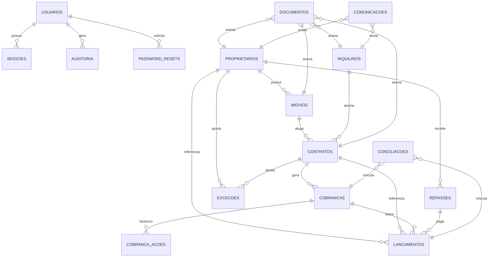

# Modelo de dados

Banco: **SQLite** via `node:sqlite`, um arquivo em `data/imobiliaria.db` (WAL
ativo). O esquema é criado e migrado em `src/db.js` na inicialização.

## Convenções

| Tipo | Convenção |
|---|---|
| Dinheiro | Inteiro em **centavos** (`aluguel_centavos`, `valor_centavos`) |
| Percentual | `REAL` (ex.: `8.5` = 8,5%) |
| Data | `TEXT` no formato `YYYY-MM-DD` |
| Competência | `TEXT` no formato `YYYY-MM` |
| Data/hora | `TEXT` `YYYY-MM-DD HH:MM:SS` em horário local |
| Booleano | `INTEGER` `0`/`1` |
| Identificador | `INTEGER PRIMARY KEY AUTOINCREMENT` |
| Exclusão | Lógica (`ativo = 0`) ou estorno; exceções de repasse podem ser removidas |

## Diagrama ER (visão principal)



> O diagrama representa as relações lógicas. `documentos` e `comunicacoes`
> usam uma referência polimórfica (`entidade` + `entidade_id`), não uma FK
> composta.

## Tabelas

### Acesso e configuração

| Tabela | Papel | Campos relevantes |
|---|---|---|
| `usuarios` | Contas e papéis | `nome`, `email` (único), `senha_hash`, `papel`, `ativo`, `deve_trocar_senha`, `totp_secret`, `totp_ativo`, `totp_recovery` |
| `sessoes` | Sessões ativas | `token` (hash SHA-256), `usuario_id`, `expira_em` |
| `password_resets` | Links de recuperação | `usuario_id`, `token_hash`, `expira_em`, `usado_em`, `ip` |
| `auditoria` | Trilha de ações | `usuario_id`, `usuario_nome`, `acao`, `entidade`, `entidade_id`, `detalhe` (JSON), `ip`, `criado_em` |
| `settings` | Regras editáveis | `chave`, `valor`, `rotulo`, `grupo`, `tipo`, `opcoes`, `editavel` |

### Carteira

| Tabela | Papel | Campos relevantes |
|---|---|---|
| `proprietarios` | Donos dos imóveis | `nome`, `cpf_cnpj`, contatos, dados bancários, `pix`, `taxa_admin_pct`, `ativo` |
| `imoveis` | Carteira física | `proprietario_id`, endereço, `tipo`, `situacao`, `taxa_admin_pct`, `ativo` |
| `inquilinos` | Locatários | `nome`, `cpf_cnpj`, contatos, `ativo` |
| `contratos` | Relação jurídica/financeira | `codigo`, `imovel_id`, `inquilino_id`, vigência, `aluguel_centavos`, `dia_vencimento`, índice, garantia, `taxa_admin_pct`, `status` |
| `excecoes` | Ajuste pontual do repasse | `contrato_id`, `competencia`, `tipo` (`desconto`/`acrescimo`), `valor_centavos`, `motivo` |

### Recebíveis e cobrança

| Tabela | Papel | Campos relevantes |
|---|---|---|
| `cobrancas` | O que deveria entrar | `contrato_id`, `competencia`, `vencimento`, `valor_original_centavos`, `multa_centavos`, `juros_centavos`, `desconto_centavos`, `valor_pago_centavos`, `status`, `cobranca_status`, `data_pagamento`, `responsavel`, `proxima_acao`, `proxima_data` |
| `cobranca_acoes` | Histórico da régua | `cobranca_id`, `tipo`, `descricao`, `responsavel`, `proxima_acao`, `proxima_data` |
| `conciliacoes` | Transações bancárias importadas | `origem`, `fitid`, `data`, `valor_centavos`, `descricao`, `status`, vínculos e sugestão |

Restrição importante: `UNIQUE (contrato_id, competencia)` em `cobrancas`.
Isso garante idempotência da geração mensal.

### Caixa e repasses

| Tabela | Papel | Campos relevantes |
|---|---|---|
| `lancamentos` | Livro caixa | `data`, `competencia`, `tipo` (`receita`/`despesa`), `categoria`, `valor_centavos`, `caixa`, vínculos, `status`, `estorno_de_id`, `repasse_id`, `cobranca_id` |
| `repasses` | Apuração por proprietário | `competencia`, `proprietario_id`, componentes do cálculo, `valor_centavos`, `detalhe_json`, `status`, `pago_em` |
| `fechamentos` | Bloqueio mensal | `competencia` (única), `fechado_por`, `fechado_em`, `reaberto_por`, `reaberto_em`, `motivo_reabertura` |

Restrição importante: `UNIQUE (competencia, proprietario_id)` em `repasses`.

### Documentos e comunicação

| Tabela | Papel | Campos relevantes |
|---|---|---|
| `documentos` | Arquivos e versões | `entidade`, `entidade_id`, `nome`, `mime`, `tamanho`, `caminho`, `categoria`, `descricao`, `grupo`, `versao`, `atual`, `validade`, `ativo` |
| `comunicacoes` | Histórico de envios | `canal`, `entidade`, `entidade_id`, destinatário, `assunto`, `mensagem`, `status`, `erro`, `usuario` |

O arquivo físico fica em `data/uploads/<uuid><ext>`. O nome original é preservado
apenas no banco; o caminho no disco é aleatório.

## Invariantes

1. **Um contrato ativo não pode gerar duas cobranças na mesma competência.**
2. **Um proprietário não pode ter dois repasses na mesma competência.**
3. **Uma competência só pode ter um fechamento.**
4. **Lançamentos não são excluídos**: recebem `status = 'estornado'` e geram um
   lançamento contrário.
5. **Cobrança paga não é cancelada**: é necessário estornar a baixa.
6. **Repasse pago não é recalculado.**
7. **Documentos inativos não são servidos**; versões antigas permanecem no banco.
8. **Dados pessoais anonimizados não são reconstruídos** pelo histórico de
   auditoria (o detalhe é substituído).
9. **Valores monetários nunca são `REAL`**; a conversão para reais ocorre apenas
   na apresentação.

## Índices

```sql
idx_cobrancas_comp        (competencia, status)
idx_cobrancas_contrato    (contrato_id)
idx_conciliacoes_status   (status)
idx_lanc_comp             (competencia)
idx_lanc_prop             (proprietario_id)
idx_contrato_imovel       (imovel_id)
idx_docs_entidade         (entidade, entidade_id)
idx_reset_hash            (token_hash)
```

Para o volume previsto, os índices cobrem as consultas mais frequentes. Consultas
analíticas fazem varredura de `lancamentos` por período; se o volume crescer,
o próximo passo é materializar uma tabela mensal ou migrar para PostgreSQL.

## Migrações

O projeto não usa uma ferramenta de migração. `garantirColuna(tabela, coluna,
definição)` adiciona colunas novas em bancos existentes sem perder dados. Regras:

- mudanças devem ser **aditivas** e compatíveis com bancos antigos;
- nunca renomeie ou remova uma coluna sem uma migração de dados;
- crie um índice novo com `CREATE INDEX IF NOT EXISTS`;
- teste abrindo um banco antigo e executando o servidor.

## Backup e restauração

O backup usa `VACUUM INTO`, que gera uma cópia consistente mesmo com o banco em
WAL. O ZIP inclui banco, `documentos/` e, quando existir, `.app-key` (chave que
decifra os segredos de 2FA). Restauração:

1. pare o servidor;
2. substitua `data/imobiliaria.db`;
3. remova `imobiliaria.db-wal` e `imobiliaria.db-shm` antigos;
4. copie `documentos/` para `data/uploads`;
5. copie `.app-key` para `data/.app-key`, se presente;
6. confirme permissões `0700`/`0600` e suba o serviço.

Detalhes operacionais em [OPERACAO.md](OPERACAO.md).
