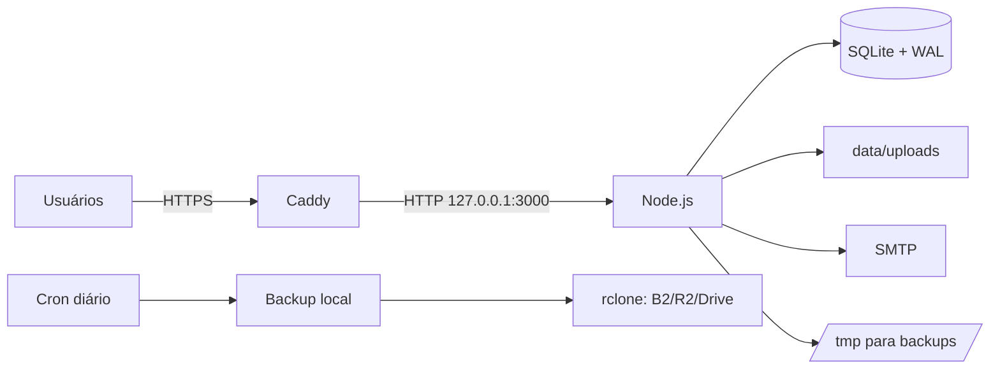

# Operação

Guia para manter o sistema rodando em produção. A instalação inicial está em
[deploy/README.md](../deploy/README.md); este documento cobre o dia a dia,
backup, restauração e incidentes.

## Topologia



- Um único processo Node escrevendo no SQLite. Não rode duas instâncias no mesmo
  `DATA_DIR`.
- O banco deve ficar em disco local; nunca em OneDrive, Google Drive ou pasta de
  rede com o servidor ativo.
- Caddy termina TLS e encaminha para `127.0.0.1:3000`.

## Variáveis de ambiente

| Variável | Obrigatória | Uso |
|---|---|---|
| `NODE_ENV=production` | recomendada | Desliga dicas de desenvolvimento e endurece URLs |
| `HOST=127.0.0.1` | sim | Não expor o Node direto na internet |
| `PORT=3000` | sim | Porta interna |
| `TRUST_PROXY=1` | atrás de proxy | Usa `X-Forwarded-For` para rate limit. Se o cabeçalho chegar sem esta variável, o servidor avisa no log e todos os usuários passam a compartilhar o mesmo balde de rate limit |
| `APP_SECRET` | recomendada | Cifra segredos de 2FA e códigos de recuperação |
| `ADMIN_SENHA` | primeira execução | Senha inicial do admin (opcional) |
| `PUBLIC_URL` | para recuperação | Base dos links de e-mail |
| `SEED_DEMO=0` | produção | Dados de exemplo são **opt-in**: sem `SEED_DEMO=1`, a base sobe vazia em qualquer ambiente |
| `SMTP_*` | opcional | Envio de e-mail |

`APP_SECRET` e o arquivo `data/.app-key` são **segredos**. Se `APP_SECRET` não
for definido, a aplicação cria `.app-key`; perder esse arquivo impede decifrar
os segredos de 2FA. O backup automático da versão 0.6 inclui `.app-key` quando
ele existe.

## Rotina

### Diária

- [ ] Verificar `/api/health` (ou o monitor HTTP). Ele retorna `503` quando o
  banco não responde ou `data/uploads` não está gravável.
- [ ] Conferir se o backup da madrugada foi enviado para fora.
- [ ] Revisar alertas de cobrança e vencimento.
- [ ] Verificar erros no log do serviço.

### Semanal

- [ ] Conferir espaço em disco (`df -h`).
- [ ] Revisar repasses pendentes e cobranças em atraso.
- [ ] Validar que o último backup tem tamanho compatível com o banco.
- [ ] Revisar usuários ativos e permissões.

### Mensal

- [ ] **Testar a restauração** em uma cópia e registrar data/responsável.
- [ ] Rodar `npm audit` e planejar atualizações.
- [ ] Revisar retenção de auditoria e LGPD.
- [ ] Revisar taxas, multa e juros com a imobiliária.
- [ ] Fechar a competência e conferir relatórios.

## Backup

### Pelo sistema

**Relatórios → Backup** gera um ZIP com:

- `imobiliaria.db` (cópia consistente via `VACUUM INTO`);
- `documentos/` (arquivos de upload);
- `.app-key` (se existir);
- `LEIA-ME.txt` com instruções.

**Relatórios → Verificar integridade** abre a cópia e conta registros das
principais tabelas.

O ZIP contém dados pessoais e possivelmente segredos. Guarde-o criptografado e
fora do servidor.

### Automático (VPS)

`deploy/backup.sh` usa `sqlite3 .backup`, valida `PRAGMA integrity_check`, gera
tar dos uploads, envia via `rclone` e mantém 30 dias locais. Configure
`RCLONE_REMOTE` e agende no cron:

```bash
15 2 * * * /usr/local/bin/imobiliaria-backup.sh >> /var/log/imobiliaria-backup.log 2>&1
```

### Restauração

1. Avise os usuários e pare o serviço.
2. Faça uma cópia do estado atual (mesmo que quebrado).
3. Baixe o backup mais recente e confira o checksum/tamanho.
4. Pare o serviço: `sudo systemctl stop imobiliaria`.
5. Substitua `data/imobiliaria.db`.
6. Remova `data/imobiliaria.db-wal` e `data/imobiliaria.db-shm`.
7. Extraia `documentos/` em `data/uploads`.
8. Copie `.app-key` para `data/.app-key`, se presente.
9. Ajuste dono e permissões: `chown -R imobiliaria:imobiliaria data` e `chmod 600` no banco.
10. Suba o serviço e valide: login, painel, um contrato, um documento, um PDF,
    um repasse e um relatório.
11. Registre a restauração (data, responsável, backup usado, resultado).

## Atualização de versão

```bash
cd /opt/imobiliaria
sudo -u imobiliaria git pull            # ou copie o pacote
sudo -u imobiliaria npm ci --omit=dev
sudo -u imobiliaria npm run deps:check  # garante o xlsx do CDN
sudo systemctl restart imobiliaria
curl -fsS http://127.0.0.1:3000/api/health
```

## Desligamento e reinício

O processo trata `SIGTERM`/`SIGINT`: para de aceitar conexões, conclui as
requisições em curso e fecha o SQLite (consolidando o WAL) antes de sair. Em
caso de travamento, há um limite de 10 s para o encerramento forçado. Não use
`kill -9` no dia a dia: `systemctl restart` já envia `SIGTERM`.

## Mídia da demonstração

`docs/assets` tem ~7,7 MB de capturas e vídeo versionados no Git. Se o clone
começar a pesar, mova esses arquivos para Git LFS ou anexos de release e ajuste
os links do README. Isso **não** afeta a instalação de produção, que não usa
`docs/`.

Antes:

- leia o [CHANGELOG](../CHANGELOG.md);
- faça backup;
- teste em uma cópia/staging quando a mudança envolver banco ou regra financeira.

O esquema usa migrações aditivas (`garantirColuna`). Ainda assim, nunca atualize
sem backup.

## Monitoramento

- Monitor HTTP em `https://seu-dominio/api/health` a cada 5 minutos.
- Alerta de disco acima de 80%.
- Alerta de falha no cron de backup.
- Verificação semanal do log do Caddy e do `journalctl -u imobiliaria`.
- O sistema não envia telemetria.

## Runbooks

### Site fora do ar

1. `systemctl status imobiliaria`;
2. `journalctl -u imobiliaria -n 100 --no-pager`;
3. `curl -i http://127.0.0.1:3000/api/health`;
4. `systemctl status caddy` e `journalctl -u caddy -n 50`;
5. verifique disco (`df -h`) e memória (`free -m`);
6. se o banco estiver corrompido, restaure o último backup validado.

### “Database is locked” / escrita travada

1. confirme que só há um processo Node usando o `DATA_DIR`;
2. verifique se o banco não está em pasta de rede;
3. veja se há transação longa ou backup externo concorrente;
4. reinicie o serviço;
5. se persistir, faça backup e rode `PRAGMA integrity_check`.

### Disco cheio

1. identifique o consumo (`du -sh data/* /var/backups/*`);
2. remova backups locais antigos, mantendo os externos;
3. aumente o disco ou mova uploads;
4. reinicie o serviço e confirme o health.

### Ninguém consegue entrar

1. tente outro administrador;
2. use **Esqueci minha senha** (precisa de SMTP + URL pública);
3. no servidor:

```bash
cd /opt/imobiliaria
npm run admin:reset -- --email admin@imobiliaria.local
```

O comando gera senha temporária, desativa 2FA, invalida sessões e força troca.

### 2FA perdido

- outro admin pode usar **Usuários → Resetar 2FA**;
- ou redefinir a senha do usuário (isso também desativa o 2FA no reset
  administrativo de senha? **Não**: o reset de senha não remove o 2FA; use a rota
  `resetar-2fa` ou a CLI `admin:reset`);
- a CLI desativa o 2FA do admin alvo.

### E-mail não sai

1. confira `SMTP_HOST`, `SMTP_PORT`, `SMTP_SECURE`, `SMTP_USER`, `SMTP_PASS` e
   `SMTP_FROM`;
2. teste o provedor fora do sistema;
3. verifique SPF/DKIM e senha de aplicativo (Gmail);
4. veja o histórico em **Comunicação** e o log do serviço;
5. sem SMTP, a recuperação de senha fica registrada para o admin.

### Backup falhou

1. rode `deploy/backup.sh` manualmente;
2. verifique permissões de `data/` e do diretório de backup;
3. confira a configuração do `rclone` com `rclone lsd remote:`;
4. não apague o último backup bom;
5. registre o incidente.

## Segurança operacional

- Mantenha o SO e o Node atualizados.
- Não exponha a porta 3000.
- Use HTTPS e `TRUST_PROXY=1` somente atrás do proxy.
- Restrinja o acesso ao `/etc/imobiliaria.env` (`chmod 600`).
- Tenha pelo menos dois administradores ativos.
- Revise usuários inativos e remova acessos.
- Guarde `APP_SECRET`/`.app-key` no gerenciador de senhas.
- Trate o ZIP de backup como documento confidencial.

## LGPD e retenção

Configurações → LGPD define encarregado, e-mail e prazos de retenção. A
anonimização remove dados pessoais e documentos, mas preserva contratos e
histórico financeiro por obrigação legal. A revisão jurídica da base legal,
política de privacidade e prazos é responsabilidade da empresa.
