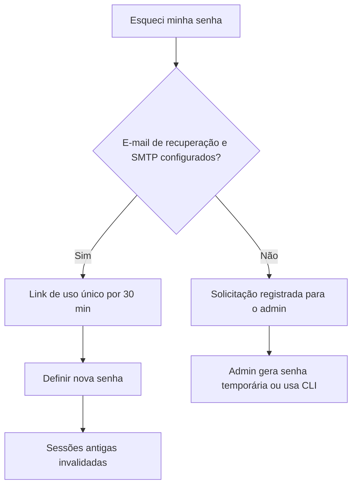
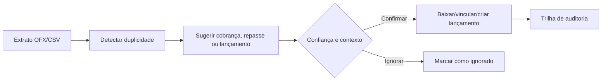
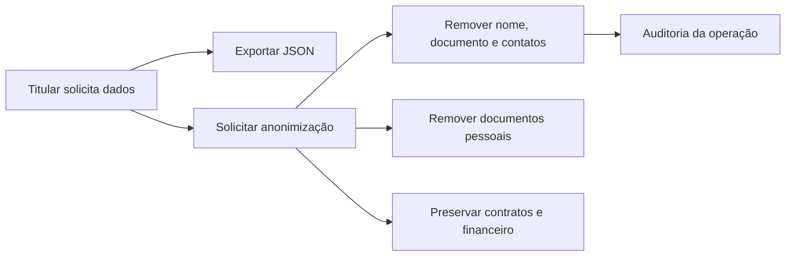

# Produto

## Visão em uma frase

Um sistema web de gestão para imobiliárias de pequeno porte que transforma
contratos, aluguéis e repasses em uma operação rastreável — do cadastro ao
comprovante de repasse.

## Contexto

Imobiliárias familiares costumam operar com uma combinação de planilhas,
mensagens e memória. Funciona enquanto o volume é pequeno, mas cria três
problemas estruturais:

1. **Fonte única inexistente.** O mesmo aluguel aparece na planilha, no extrato
   e no WhatsApp, com valores ou datas diferentes.
2. **Cálculo de repasse inexplicável.** Cada proprietário pode ter uma taxa
   diferente; refazer o cálculo meses depois é caro e gera desconfiança.
3. **Nenhuma trilha de auditoria.** Não se sabe quem alterou um valor, quando ou
   por quê.

O projeto parte de um cenário real de administração de imóveis de terceiros:
a imobiliária recebe o aluguel, desconta a taxa e as despesas autorizadas e
repassa o saldo ao proprietário.

## Objetivos

- Centralizar proprietários, imóveis, inquilinos, contratos e documentos.
- Medir o que **deveria** entrar (cobranças), não apenas o que entrou.
- Explicar cada repasse linha a linha, com a taxa e a origem da regra.
- Separar o dinheiro da imobiliária do dinheiro dos proprietários.
- Dar suporte a celular, teclado e conexões lentas.
- Permitir operação e backup sem equipe de infraestrutura dedicada.
- Demonstrar boas práticas de segurança, testes e documentação.

## Não objetivos

- Substituir um ERP contábil completo.
- Processar boletos, Pix ou cartões diretamente.
- Ser multiempresa/multifilial nesta versão.
- Atender milhares de usuários simultâneos.
- Guardar documentos com valor legal sem revisão jurídica e operacional.

## Personas

| Persona | Necessidade principal | O que faz no sistema |
|---|---|---|
| **Administrador** | Controlar acesso, regras, fechamento e backup | Configura a empresa, usuários, taxas, prazos, LGPD e restauração |
| **Operador** | Executar o ciclo mensal sem erro | Cadastra, gera cobranças, dá baixa, concilia, calcula e paga repasses |
| **Consulta** | Ver informação sem alterar | Consulta painel, cadastros, contratos, cobranças e relatórios permitidos |
| **Proprietário** (indireto) | Entender o valor recebido | Recebe extrato/PDF e documentos; não acessa o sistema nesta versão |
| **Inquilino** (indireto) | Saber o que e quando pagar | Recebe cobrança por WhatsApp/e-mail; não acessa o sistema nesta versão |

## Jornada principal

### O ciclo mensal em detalhe

1. **Antes do mês:** o contrato precisa estar ativo, com aluguel, vencimento,
   índice de reajuste e garantia preenchidos.
2. **Geração:** a imobiliária gera as cobranças da competência. Cada contrato
   ativo e vigente recebe uma cobrança; a operação é idempotente.
3. **Recebimento:** cada pagamento é baixado total ou parcialmente. Multa e juros
   entram conforme a configuração.
4. **Conciliação:** o extrato OFX/CSV é importado; o sistema sugere vínculos, mas
   a confirmação é humana.
5. **Repasse:** o sistema soma os aluguéis recebidos, desconta taxa, despesas,
   descontos e soma acréscimos. O resultado é gravado com um snapshot.
6. **Pagamento:** o repasse gera a saída no caixa dos proprietários e a receita
   da taxa no caixa da imobiliária.
7. **Fechamento:** a competência é bloqueada. Correções exigem reabertura pelo
   administrador, com motivo, ou estorno.

## Escopo da versão 0.6

### Dentro do escopo

- Cadastros de proprietários, imóveis, inquilinos, contratos e exceções.
- Painel analítico com KPIs, séries, comparativos, composição e ocupação.
- Cobranças com geração em lote, baixa, estorno, cancelamento, aging e régua.
- Conciliação bancária OFX/CSV com sugestão e confirmação.
- Dois caixas, lançamentos, estornos, repasses e fechamento mensal.
- Documentos versionados, com validade e pré-visualização.
- Importação de planilhas com prévia e atualização.
- Relatórios em CSV, XLSX e PDF.
- Comunicação manual por WhatsApp (`wa.me`) e e-mail (SMTP).
- Usuários, papéis, auditoria, 2FA, LGPD e backup verificado.
- Instância de demonstração separada da produção.

### Fora do escopo (por enquanto)

- Portal do proprietário e do inquilino.
- Boleto/Pix automático e API oficial do WhatsApp.
- Assinatura digital, OCR e antivírus no upload.
- Contas a pagar/receber com recorrência e previsão de caixa.
- Multiempresa, comissões, DRE por imóvel e integração contábil.
- Aplicativo nativo.

O detalhamento e a ordem estão no [roadmap](roadmap.md).

## Regras de negócio

As regras abaixo são a fonte de verdade do produto. Quando o código e este
documento divergirem, o código deve ser corrigido ou a regra deve ser revista —
nunca as duas coisas silenciosamente.

| ID | Regra | Onde vive |
|---|---|---|
| RN-01 | Dinheiro é armazenado em centavos inteiros; percentuais em `REAL` | `db.js`, módulos financeiros |
| RN-02 | A taxa de administração segue a precedência **contrato > imóvel > proprietário > regra geral** | `regras.js` |
| RN-03 | O repasse guarda um **snapshot** do cálculo; mudar uma taxa depois não altera competência já calculada | `regras.js` |
| RN-04 | Existem dois caixas: `imobiliaria` e `proprietarios`; aluguel entra no caixa dos proprietários e taxa no da imobiliária | `regras.js`, `api.js` |
| RN-05 | O repasse é `aluguéis recebidos − taxa − despesas − descontos + acréscimos` | `regras.js` |
| RN-06 | O pagamento do repasse não é despesa de uma nova apuração | `regras.js` |
| RN-07 | Contrato encerrado depois do recebimento continua no repasse da competência em que houve aluguel | `regras.js` |
| RN-08 | Nada é apagado: lançamentos e baixas usam estorno; cadastros são desativados; contratos são encerrados | `api.js`, `cobrancas.js` |
| RN-09 | Competência fechada bloqueia novos lançamentos, cobranças, baixas e repasses | `regras.js` |
| RN-10 | A geração de cobranças é idempotente: uma cobrança por contrato e competência | `cobrancas.js`, índice único |
| RN-10a | Um imóvel só pode ter um contrato ativo por vez, e o código do contrato é único | `api.js` |
| RN-11 | Pagamento parcial mantém saldo e é tratado como inadimplência enquanto houver saldo | `cobrancas.js`, `regras.js`, `reports.js` |
| RN-12 | Vencimento em fim de semana pode ser prorrogado para o próximo dia útil (configurável) | `cobrancas.js` |
| RN-13 | Contrato iniciado no meio do mês pode gerar cobrança proporcional (configurável) | `cobrancas.js` |
| RN-14 | Reajuste é sugerido a cada 12 meses a partir do último reajuste ou do início | `regras.js` |
| RN-15 | Alertas usam prazos configuráveis para contrato, reajuste, garantia e atraso | `regras.js` |
| RN-16 | O perfil `consulta` não escreve nem exporta; CPF/CNPJ pode ser mascarado | `permissoes.js`, `api.js` |
| RN-17 | Toda escrita relevante gera auditoria com usuário, ação, entidade, detalhe e IP | `permissoes.js` |
| RN-18 | Documentos ficam fora da pasta pública; download exige sessão e é auditado | `documentos.js` |
| RN-19 | LGPD: exportação do titular e anonimização preservam o histórico financeiro obrigatório | `api.js` |
| RN-20 | O backup inclui banco, documentos e, quando existir, a chave local de 2FA | `api.js` |

## Jornadas secundárias

### Recuperação de acesso

### Conciliação bancária

### Proteção de dados

## Requisitos não funcionais

| Requisito | Meta prática |
|---|---|
| Usuários simultâneos | 5 a 20, com um processo Node |
| Volume esperado | Centenas de imóveis/contratos, milhares de lançamentos por ano |
| Tempo de resposta | Painel e listas abaixo de 1 s em VPS pequena |
| Disponibilidade | Horário comercial; tolerância a reinício rápido |
| Persistência | SQLite em disco local, WAL, backup externo diário |
| Segurança | Sessão server-side, autorização no servidor, CSP, rate limit |
| Privacidade | LGPD: minimização, exportação, anonimização e retenção configurável |
| Acessibilidade | Navegação por teclado, foco visível, contraste e textos alternativos |
| Responsividade | Layout utilizável em telas de 360 px |
| Operação | Um comando para subir, um para testar, um para backup |

## Métricas de sucesso

O projeto não coleta telemetria. As métricas são operacionais e qualitativas:

- tempo para gerar e baixar uma competência;
- quantidade de lançamentos manuais por mês;
- repasses refeitos ou contestados;
- tempo para localizar um documento ou contrato;
- restaurações de backup testadas com sucesso;
- falhas de acesso ou incidentes de segurança registrados.

## Glossário

| Termo | Significado |
|---|---|
| **Competência** | Mês de referência financeira (`YYYY-MM`), independente da data do pagamento |
| **Repasse** | Valor devido ao proprietário após descontos e acréscimos |
| **Taxa de administração** | Percentual retido pela imobiliária sobre o aluguel recebido |
| **Snapshot** | Cópia congelada do cálculo no momento em que o repasse foi gerado |
| **Caixa** | Separação lógica entre dinheiro próprio e de terceiros |
| **Estorno** | Lançamento contrário que anula um lançamento sem apagá-lo |
| **Aging** | Distribuição do saldo vencido por faixas de atraso |
| **Régua de cobrança** | Status, responsável, próxima ação e histórico de contato |
| **FITID** | Identificador único de transação bancária no formato OFX |
| **TOTP** | Código temporário de 6 dígitos usado no 2FA |
| **LGPD** | Lei Geral de Proteção de Dados (Lei 13.709/2018) |
